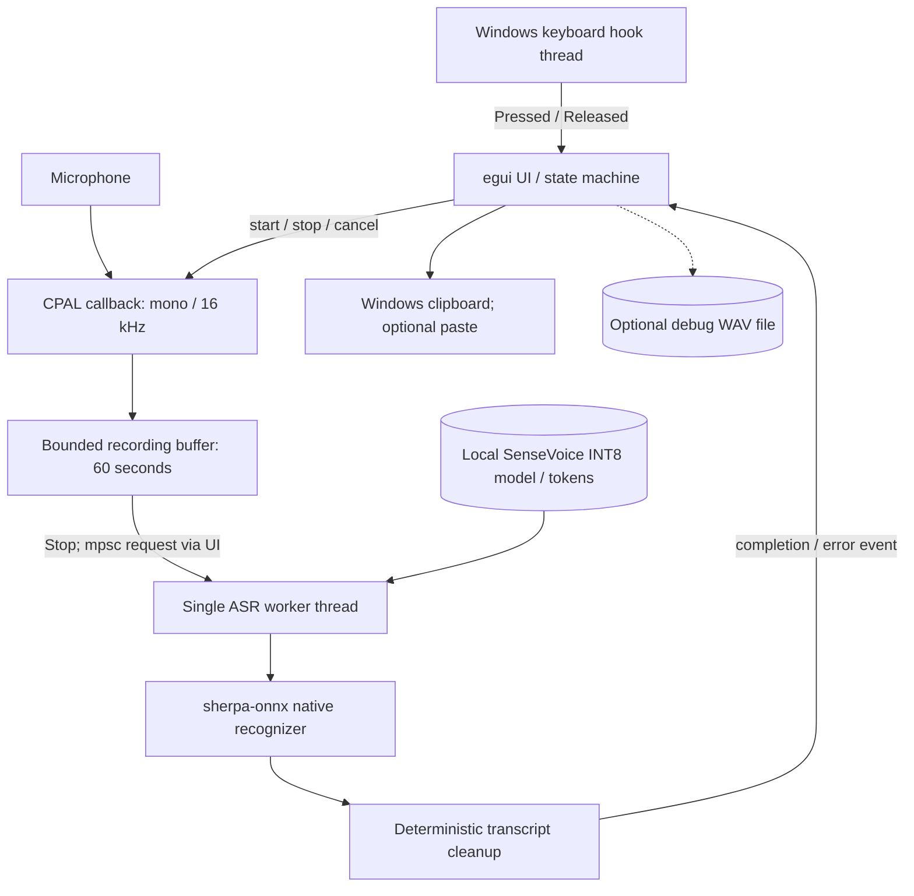

# TinySTT

Offline push-to-talk speech recognition for Windows using SenseVoice INT8 and sherpa-onnx.

[简体中文](README.zh-CN.md) · [v0.1.0 download](https://github.com/styayur/TinySTT/releases/tag/v0.1.0) · [Usage reference](docs/USAGE.md)

**Early preview.** Hold `Ctrl+Alt+D`, speak, release, then read or copy the transcript. The app runs local CPU inference without uploading audio or transcripts. The unsigned portable download and source builds both require a separately downloaded model.

## Actual recognition output

From the extracted v0.1.0 portable directory after installing the model:

```powershell
.\TinySTT.exe --file .\models\sensevoice\test_wavs\en.wav --model-dir .\models\sensevoice --language en
```

Actual stdout recorded on 09-10-2026:

```text
The tribal chieftain called for the boy and presented him with 50 pieces of code.
```

This unedited bundled-sample result demonstrates file inference, not microphone capture, a GUI screenshot or an accuracy benchmark. The final word is preserved as recognized. See [demonstration provenance](docs/architecture/DEMONSTRATION.md).

## Install and first run

Use Windows x64. Download the ZIP and `SHA256SUMS.txt` from [v0.1.0](https://github.com/styayur/TinySTT/releases/tag/v0.1.0), compare the archive's full SHA-256 to its matching entry, and extract it. The package includes the EXE, configuration example, notices and an empty model directory. It is not signed; checksums establish consistency with the published package, not a code signature.

In the extracted directory, download the pinned SenseVoice archive, verify **before** extraction, and move it into the default layout. These commands are for a new installation; do not overwrite an existing `models/sensevoice` directory.

```powershell
New-Item -ItemType Directory -Force models | Out-Null
curl.exe -L -o sensevoice.tar.bz2 `
  https://github.com/k2-fsa/sherpa-onnx/releases/download/asr-models/sherpa-onnx-sense-voice-zh-en-ja-ko-yue-int8-2024-07-17.tar.bz2

Get-FileHash .\sensevoice.tar.bz2 -Algorithm SHA256
$expected = '7D1EFA2138A65B0B488DF37F8B89E3D91A60676E416F515B952358D83DFD347E'
if ((Get-FileHash ./sensevoice.tar.bz2 -Algorithm SHA256).Hash -ne $expected) { throw 'Model checksum mismatch' }

tar -xf .\sensevoice.tar.bz2 -C .\models
Move-Item `
  .\models\sherpa-onnx-sense-voice-zh-en-ja-ko-yue-int8-2024-07-17 `
  .\models\sensevoice
Remove-Item .\sensevoice.tar.bz2
```

Required paths beside `TinySTT.exe` are `models/sensevoice/model.int8.onnx` and `models/sensevoice/tokens.txt`. Keep bundled `test_wavs` for the example above. The roughly 156 MiB model has separate terms; see [exact provenance](docs/model-provenance.md). Missing-model errors list searched paths; the app never downloads a model automatically.

```powershell
.\TinySTT.exe
```

Allow microphone access in Windows, wait for model loading, hold the shortcut, speak and release. Recognition also has Record / Stop / Cancel buttons; results are copied to the clipboard. Optional auto-paste is **off by default** because it inserts text into the focused application.

## Build from source

Install stable Rust for `x86_64-pc-windows-msvc`, Visual Studio Build Tools with **Desktop development with C++**, and a Windows-visible microphone for capture. The first native build downloads the sherpa-onnx library; runtime inference is offline.

```powershell
git clone https://github.com/styayur/TinySTT.git
cd TinySTT
cargo build --release
```

Place the model under `target/release/models/sensevoice` before running `target/release/TinySTT.exe`, or use a model-directory override. The portable download does not require Rust or C++ tools.

## Features, configuration and limits

Chinese, English, Cantonese, Japanese and Korean; one reusable ASR worker; bounded 60-second recording; tray controls; clipboard output; optional debug WAV export and microphone-free WAV CLI. Recordings below 250 ms are ignored; new recording is rejected while recognition is busy. There is no VAD, streaming partial text, diarization or in-flight ASR cancellation.

Settings live in `config/config.toml` beside the EXE; start from [config.example.toml](config.example.toml). Model path, inference threads (1/2/4) and language changes require restart. Hotkey, microphone and auto-paste changes apply after saving/on the next recording. The [usage reference](docs/USAGE.md#configuration) covers every key and CLI override.

No account, telemetry, update check or runtime HTTP service is used. Logs exclude raw audio and full transcripts, but clipboard delivery and explicitly exported WAV files require local data care. Model quality, microphone/driver behavior and global shortcut conflicts need real-device validation; mock tests do not prove those properties.

## Architecture

<!-- architecture:overview:start -->

<!-- architecture:overview:end -->

Capture is downmixed/resampled in Rust. The UI submits stopped recordings to one serial ASR worker and handles its result/error. Cancellation discards buffered audio before inference; it cannot interrupt running ASR. [Source evidence](docs/architecture/README.md) and [thread/state details](docs/architecture.md) explain the boundaries.

## Tests and contributing

From the repository root:

```powershell
cargo fmt --all -- --check
cargo clippy --all-targets --all-features -- -D warnings
cargo test --all --all-features
cargo build --release
```

[Windows CI](https://github.com/styayur/TinySTT/actions/workflows/ci.yml) uses these checks. Unit tests use a fake recognizer, not the real model. See [CONTRIBUTING.md](CONTRIBUTING.md), [Issues](https://github.com/styayur/TinySTT/issues), [SECURITY.md](SECURITY.md) and [CHANGELOG.md](CHANGELOG.md). Signed delivery, microphone UI and possible partial transcripts remain roadmap ideas, not current features. The [reference](docs/USAGE.md#roadmap) preserves the scoped roadmap and troubleshooting.

## License

Application source uses [AGPL-3.0-only](LICENSE). SenseVoice, sherpa-onnx, ONNX Runtime and other components retain their own terms in [THIRD_PARTY_NOTICES.md](THIRD_PARTY_NOTICES.md) and [model provenance](docs/model-provenance.md).
